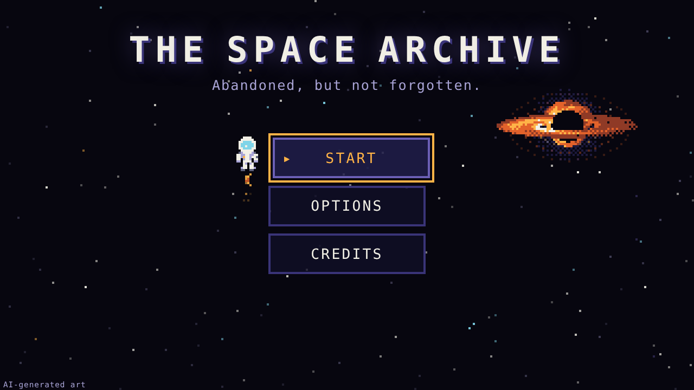
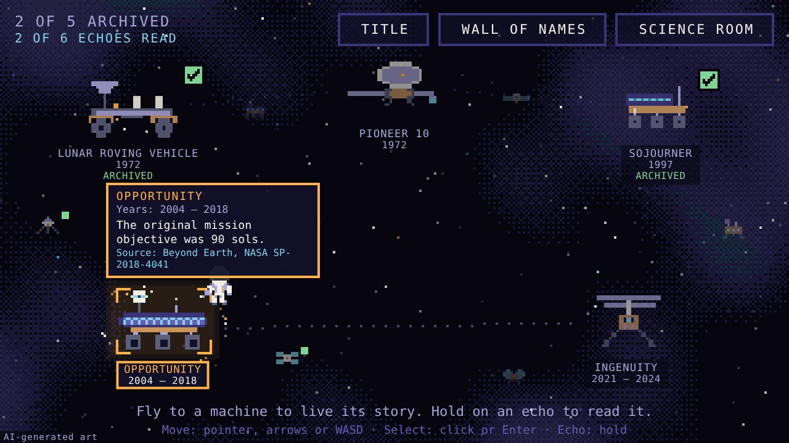
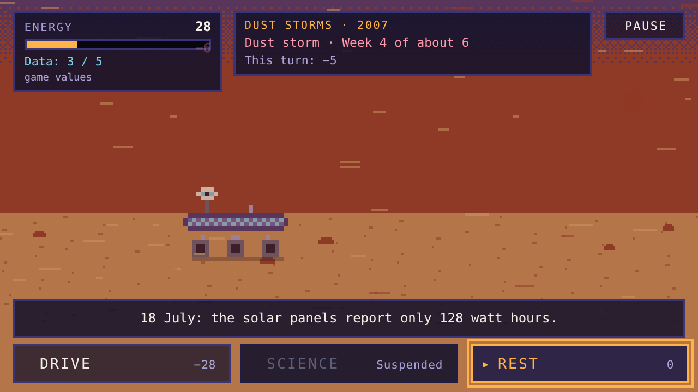
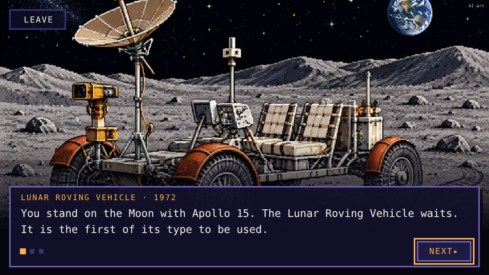
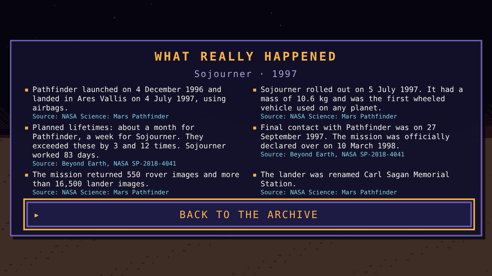

# The Space Archive

*Abandoned, but not forgotten.*

Play online: https://dam2323.github.io/The-Space-Archive/ (available once GitHub Pages is enabled for this repository)

## Concept

The Space Archive is a short educational pixel-art browser game made for the 2026 NASA Space Apps Challenge (Lima), challenge "Abandoned but Not Forgotten: Storytelling about NASA's Discarded Equipment on the Moon and Mars". The player is an astronaut who orbits a black hole, arrives at The Archive and lives the real stories of five machines: the Apollo Lunar Roving Vehicle, Pioneer 10, Sojourner, Opportunity and Ingenuity. Around them drift six echoes with short fact cards, and a Wall of Names lists the other official resources.

The black hole frame is narrative fiction based on general relativity (near a black hole time runs slower, so you can only travel toward the future). It is not a NASA claim.

## Screenshots


*The title screen.*


*The Archive, where you choose a machine.*


*The Opportunity mini-game.*


*A story screen with an illustrated frame.*


*A "What really happened" card.*

More screenshots are in the screenshots folder.

## How to play

- Mouse or touch: in The Archive the astronaut flies toward your pointer (or the place you tap). Point at a machine or an echo, or fly near it, then click or tap to select it. Click or tap to advance the story.
- Keyboard: in The Archive, fly with the arrow keys or WASD and press Enter to select what you are near (Tab also moves between machines and echoes). Space or Enter advances text, Esc goes back.
- The intro shows two clocks: your clock and Earth's clock. Earth's clock rolls forward through the eras of the machines and stops on the present.
- Options (title screen): sound, volume, text size, reduced motion, language (English or Spanish), reset progress.
- Opportunity mini-game: each turn choose Drive, Science or Rest. Driving and science cost energy, the Sun charges you, dust reduces sunlight. Energy, costs and stars are game values, not mission data. Esc or the Pause button pauses.
- Ingenuity mini-game: hold the button (or Space) to spin the rotors and climb, release to descend. Keep the whole helicopter inside the marked zone until the bar fills, then land softly.
- Sojourner mini-game: move one square at a time with the arrow keys, the on-screen arrows, or by tapping next to the rover. Go around the rocks and reach the three targets. You have a few moves each sol.
- Lunar Roving Vehicle mini-game: hold the button (or Space) to drive, release to slow down. Stop next to each flag and slow down for craters.
- Pioneer 10 mini-game: switch the transmitter and the instruments on or off to stay inside the power budget, then let time pass. Data only reaches Earth while the transmitter is on. Budgets, costs and instrument names are game values.
- Science Room: open it from The Archive (the button at the top, or "Enter the Science Room" when all five machines are archived). Credits and sources are on the title screen and inside the Science Room. Options are also available from the Pause menu in every mini-game.
- Echoes: six smaller, dimmer machines drift around The Archive (Surveyor 3, Viking 1, NEAR Shoemaker, InSight, Spirit and Dawn). Aim at one and hold the click, the tap or Enter for half a second to scan it and read its fact card. Read echoes are saved.
- Wall of Names: a button in The Archive opens a list of the other official challenge resources, each with its official one-line description.
- When all five stories are done, the lines between the machines light up, the center pulses, and a card shows "The Archive is complete" with a short recap of what you learned.

## The five machines

| Machine | Mini-game | What you do |
| --- | --- | --- |
| Opportunity | Beyond Sol 90 | Manage energy: drive, do science or rest |
| Ingenuity | Wright Brothers Field | Take off, hover and land |
| Sojourner | Slow and Steady | Move around the rocks to reach targets |
| Lunar Roving Vehicle | Moon Drive | Drive, stop at flags, slow down for craters |
| Pioneer 10 | Power Budget | Switch the transmitter and instruments on and off as the power decays |

## Facts and sources

Every fact shown to the player comes from the project's content pack and carries a source id (see js/data/sources.js and CREDITS.md). A fact whose source is marked `needsSource: true` is hidden from the player until a citation is added: add the url and delete `needsSource: true` from that source. Numbers that belong to gameplay are marked `// GAME VALUE` in the code and labeled as game values on screen.

The real ending of each machine cannot be changed by the player.

## How to run

The game uses ES modules, so it needs a static server. From the repo root run:

```sh
python3 -m http.server 8000
```

Then open http://localhost:8000 . Any static server works.

To open a scene directly, add a URL hash: `#title`, `#intro`, `#hub`, `#science`, `#credits`, a machine id (`#opportunity`, `#ingenuity`, `#sojourner`, `#lrv`, `#pioneer10`), `#debrief:opportunity`, `#echo:viking1` and `#wall`.

## How to deploy

The game is a static site with no build step. Publish the repository root.

GitHub Pages:
1. On GitHub open the repository, then Settings, then Pages.
2. Under "Build and deployment", set Source to "Deploy from a branch".
3. Choose branch `main` and folder `/ (root)`, then Save.
4. After a minute the game is at https://dam2323.github.io/The-Space-Archive/ .

Netlify or Vercel: import the repository, leave the build command empty and set the publish directory to the repository root.

All paths in the game are relative, so it works from a subfolder. The empty `.nojekyll` file tells GitHub Pages to serve the files as they are.

## Tech notes

- Plain HTML, CSS and JavaScript ES modules.
- No frameworks, no build step, no dependencies.
- No network calls at runtime. Every file is served from this repository.
- Sprites and backgrounds are generated in code from small pixel maps. Fourteen illustrations are WebP files in `Images/`, loaded only when a screen needs them; if one fails to load, the pixel sprite is shown instead and the reason is written to the browser console.
- Text is a DOM overlay over the canvas.
- Text lives in js/data/content.en.js and js/data/content.es.js (same keys) and is read through t('key').
- Total size of the game is about 1.7 MB: about 0.32 MB of HTML, CSS and JavaScript, and about 1.36 MB of images.

File tree:

```
.nojekyll
index.html
css/style.css
js/main.js
js/state.js
js/engine/   loop.js, scenes.js, render.js, input.js, audio.js, storage.js, i18n.js, fx.js, ui.js
js/scenes/   title.js, options.js, intro.js, hub.js, portal.js, story.js, game.js, debrief.js, echo.js, wall.js, science.js, credits.js
js/minigames/ index.js, common.js, opportunity.js, ingenuity.js, sojourner.js, lrv.js, pioneer10.js
js/data/     palette.js, sprites.js, content.en.js, content.es.js, sources.js
```

## Accessibility

- Keyboard only, mouse and touch all work.
- Text size option.
- Reduced motion option (off by default, chosen only in Options): no screen shake, flashes, parallax, ripples, dashes or flips. The game stays gently alive: stars twinkle, the astronaut bobs, and the intro clock still counts the years.
- Sound toggle and volume.
- English and Spanish.
- Text is real DOM text, not drawn on the canvas.

## How AI tools were used

AI coding assistants (Claude Code) were used to write the code, to produce the pixel art (as pixel maps in code) and the synthesized sound, to draft and translate the game text, to draft the documentation, and to help check the game text against the sources.

The idea, the story frame, the choice of machines, the rules and the list of allowed facts were defined by the developer, who reviewed the result.

Fourteen illustrations in `Images/` were made with an AI image tool and reviewed by Juan: the Lunar Roving Vehicle, Pioneer 10, Sojourner, Opportunity, Ingenuity, Surveyor 3, Viking 1, NEAR Shoemaker, InSight, Spirit, Dawn, the Apollo lunar module, ALSEP and Kepler. They were cleaned before use: the nameplate with a logo and a name was cropped out of every picture, the flags on the Lunar Roving Vehicle and the flag and country name on the lunar module were painted over, and the text labels on the ALSEP picture were painted out. They were then optimized for the web (WebP, 960x540, each under 150 KB, about 1.36 MB in total). Each picture carries a small "AI art" badge in its top right corner. They are illustrations, not photos and not NASA images, and some details differ from the real machines and places.

Screens that show only pixel sprites carry no badge. No NASA logos, insignia, flags or mission patches are used.

## External resources

No third-party code, libraries, fonts or audio files are used, and the game makes no network requests while it runs. The only images are the fourteen AI-generated illustrations described above; no photos and no images from NASA or from other people are used. NASA sources are listed in CREDITS.md with their links and what each one was used for.

## License

Apache-2.0, see LICENSE.

Not affiliated with or endorsed by NASA.
